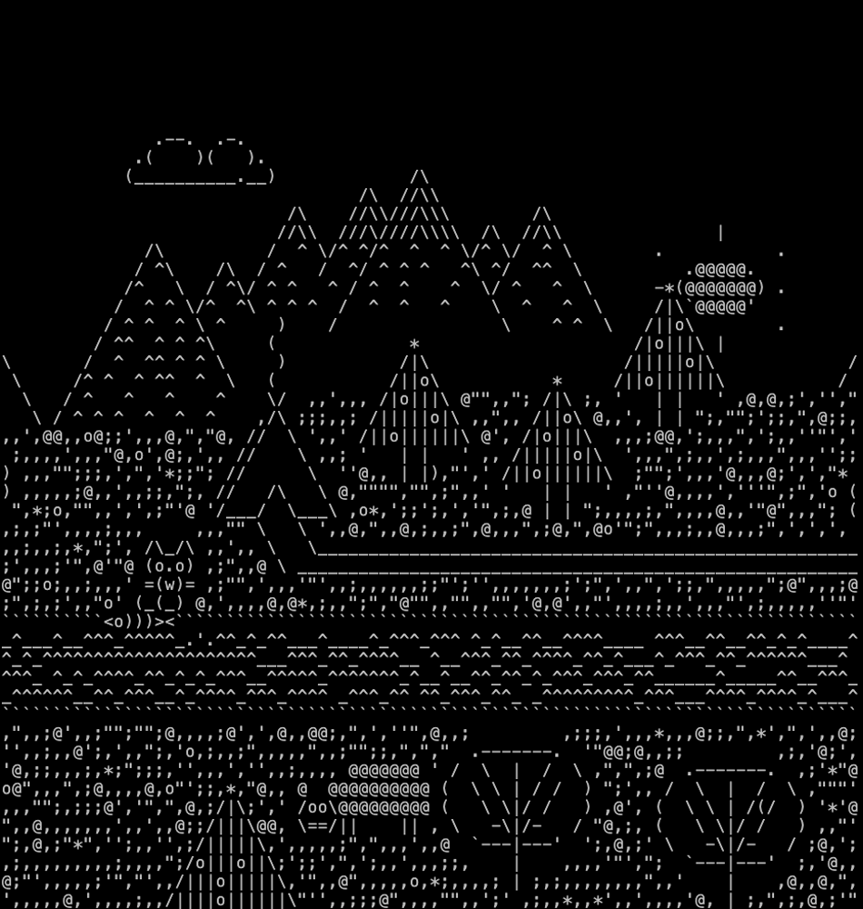

# 🏕️ Lodge

**Lodge** is a small terminal program that gives you a rest (probably after many hours of coding). Type `lodge`, and
your terminal turns into a quiet place: a small lodge by a river under a sky that follows your real clock.

It runs on **macOS** (Apple Silicon and Intel) and on **Linux** (Debian/Ubuntu, or anything with Homebrew).



## 🖥️ Installation

Pick one way. The details, updating and uninstalling are in [INSTALLATION.md](INSTALLATION.md).

**Homebrew (macOS and Linux) — recommended, and the easiest to keep up to date:**

```
brew install klukashka/lodge/lodge
```

**macOS package (.pkg):** download `lodge-<version>.pkg` from the
[latest release](https://github.com/klukashka/Lodge/releases/latest), then

```
sudo installer -pkg lodge-<version>.pkg -target /
```

The package is not signed yet, so a double click may be blocked by macOS: right-click the file → **Open** instead.

**Debian/Ubuntu (.deb):** download `lodge_<version>_amd64.deb` from the same page, then

```
sudo apt install ./lodge_<version>_amd64.deb
```

**From the sources:**

```
git clone https://github.com/klukashka/Lodge.git && cd Lodge
make && sudo make install
```

Then run:

```
lodge
```

## 👀 What you get

- **It runs right in your terminal**, like `sl`: Lodge takes over the whole screen and gives it back when you leave.
- **It fits any terminal size.** The hand-drawn picture (74×30) stays in the middle, and the world around it —
  mountains, pine forest, grass, the river and the near bank — is generated to fill whatever room there is. It does not
  change when you resize the window, minimize it or bring it back.
- **The sky follows your clock.** Day and night with a sun, a bright moon and stars that fade in at dusk; the length of
  the day follows the season. A few clouds drift by.
- **It is alive.** The river flows, the chimney smokes, now and then a gust of wind bends the smoke, sways the trees
  and speeds up the clouds, and a fish jumps out of the river.
- **It follows the seasons**, by the date and without any internet. Besides the pines there are leafy trees whose crowns
  change all year round:
  - *winter*: snow settles on the ground, the peaks and the pines, the leafy trees stand bare, snow falls slowly in
    showers (rarely by day, more often at night), the river freezes over and the fish stays under the ice, a cat in a
    hat sits by the hut and now and then blinks, and a snowman stands on the meadow at the right;
  - *spring*: the leafy trees blossom, flowers open, butterflies wander over the meadow by day;
  - *summer*: dense foliage, tall grass full of flowers, butterflies by day;
  - *autumn*: the crowns turn and thin out, leaves come off the trees and the wind carries them down, they gather in
    piles with puddles between, and a flock of birds crosses the sky in a wedge.

  Pines and leafy trees stand on the lower bank under the river too. Round bushes grow there and at the lower edge of the meadow (bare in winter, leafy the rest
  of the year); in winter snow mounds and stones lie on the bank too.

  The snow arrives over a few weeks and melts away in March. The hand-drawn picture in the middle is never touched by
  the seasons.
- **Only black and white.** Everything is plain ASCII; the moon is drawn in bold.
- **It needs a terminal of at least 74×30.** In a smaller window Lodge asks you to make it bigger and starts by itself
  as soon as there is room. Full screen looks best (Ctrl+Cmd+F in Terminal.app on a Mac, F11 in GNOME Terminal).

## ⌨️ Controls

Lodge ignores every key, the mouse and the scroll wheel, so nothing can spoil the picture. The only way out is:

- **Ctrl+C** — Lodge writes a farewell and returns you to your shell.
- **Ctrl+C twice** — leave at once, without the farewell.

(Cmd+C does not work: Terminal.app keeps it for “Copy” and never passes it to a program.)

## 🎛️ Options (environment variables)

- `LODGE_NEW_WINDOW=1` — open a separate full-screen terminal window instead of using the current one
  (on a Mac it needs the Accessibility permission for “System Events” to go full screen).
- `LODGE_HEMISPHERE=south` — mirror the seasons (day length) for the southern hemisphere.
- `LODGE_WIND_DIR=left|right` — force the wind direction (by default it is picked once per launch and never changes).
- `LODGE_DEMO=1` — a wind gust and a fish jump in every time window, to see them without waiting.
- `LODGE_SEASON=winter|spring|summer|autumn` — show that season right now (otherwise it follows the date).
- `LODGE_AT="YYYY-MM-DD HH:MM"` — start the sky clock at that moment (it also sets the date, so the season follows).
- `LODGE_TIME_SCALE=600` — run the sky clock 600 times faster, to watch a whole day pass.

Handy recipes:

```
LODGE_AT="2026-11-15 12:30" lodge                                # noon
LODGE_AT="2026-11-15 22:00" lodge                                # night, moon and stars
LODGE_AT="2026-06-21 13:00" lodge                                # a long summer day
LODGE_AT="2026-11-15 07:30" LODGE_TIME_SCALE=1500 lodge          # a whole day in about a minute
LODGE_DEMO=1 LODGE_WIND_DIR=left lodge                           # wind and fish without waiting
LODGE_SEASON=winter lodge                                        # snow, frozen river (also: spring, summer, autumn)
LODGE_AT="2026-07-01 07:30" LODGE_TIME_SCALE=40000000 lodge      # a whole year in about 40 seconds
```

## 🛠️ Troubleshooting

- **“Make this terminal bigger…”** — the window is smaller than 74×30; enlarge it or go full screen.
- **macOS says the .pkg “cannot be opened”** — it is not signed yet. Right-click → **Open**, or install it with
  `sudo installer`. Installing with Homebrew does not have this problem.
- **The scroll wheel still shows your old commands** — your terminal does not support mouse reporting. Everything else
  works; leaving Lodge restores the screen.
- **The terminal looks broken after Lodge was killed** — run `reset`.
- **`lodge: binary not found`** — the installation is incomplete; reinstall, or point `LODGE_BIN` at `lodge-bin`.

## 🧩 How it is built

One C program (`src/lodge.c`) draws every frame in memory with absolute cursor positions and repaints the whole screen,
so a resize or a minimize can never leave a broken picture. The world around the hand-drawn picture is computed from
coordinates alone (a hash, no random state), the sky from the system clock, and the wind and the fish from the elapsed
time. A small launcher (`scripts/lodge`) finds the files next to itself, so the same package works from `/usr/local`, a
Homebrew prefix or anywhere else.

```
src/            the program
include/        the picture constants
texts/          the picture and the opening message
scripts/lodge   the launcher (the `lodge` command)
deb/            Debian/Ubuntu package
macos/          macOS .pkg builder
Formula/        Homebrew formula (template for the tap)
```

## 👋 Contributing

If you're a developer, you can make a direct impact by contributing code. Clone the repository, make your changes, and
submit a pull request. To try your changes without installing anything:

```
make
LODGE_BIN=./lodge LODGE_TEXTS_DIR=./texts bash scripts/lodge
```

Not a developer? No problem! You can still contribute by creating issues, reporting bugs, or suggesting new ideas for
project improvement (do this via GitHub Issues). Your insights and feedback are invaluable to our collective success and
helps us to create a better place for taking rest.

Thank you for your contribution and support to the project!

## 📄 License

MIT, see [LICENSE](LICENSE).
